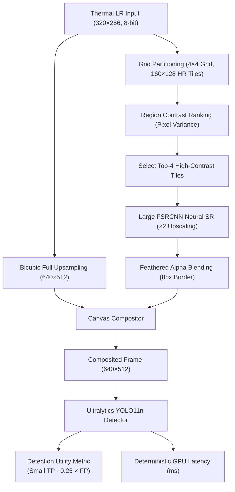

# UtiTherm-SR: Region-Selective Thermal Super-Resolution for Object Detection

*A reproducible investigation of thermal image enhancement, detection utility, and computational efficiency.*

[](LICENSE)
[](pyproject.toml)
[](Dockerfile)
[](compose.yaml)
[](tests/)
[](Dockerfile)

---

## 1. Overview

Thermal infrared cameras play an essential role in autonomous driving, defense, and nighttime surveillance by capturing emitted heat signatures independent of ambient illumination. However, commercial long-wave infrared (LWIR) sensors frequently exhibit lower spatial resolution, reduced texture detail, and higher sensor noise compared to visible-spectrum RGB sensors.

**UtiTherm-SR** investigates whether selectively applying neural super-resolution to candidate image regions containing potential objects improves downstream object detection utility compared to:
1. Standard uniform **Full-Image Bicubic Interpolation**, and
2. Uniform **Full-Image Neural Super-Resolution** (Large FSRCNN).

This repository contains the complete, frozen research pipeline for **Phase 1**, including raw dataset auditing, synthetic LR generation, FSRCNN training, YOLO11n integration, selective ROI rendering, and a bit-for-bit deterministic evaluation across 3,749 sequence-disjoint test images from the FLIR ADAS v2 dataset family.

---

## 2. Research Motivation

In resource-constrained edge computing environments (e.g., embedded automotive processors), running deep neural super-resolution networks across entire high-resolution canvases is computationally expensive. Selective region-of-interest (ROI) super-resolution offers the intuitive promise of focusing high-capacity neural processing only where objects reside, saving latency while enhancing small targets.

However, in thermal object detection, a critical tension emerges:
- **Image Enhancement vs Detection Performance:** Networks trained purely for pixel-level reconstruction error (e.g., MSE or PSNR) often sharpen high-gradient heat edges (such as building corners, exhausts, and heat plumes).
- **False Positive Inflation:** To an object detector like YOLO11n, these artificially sharpened non-object features can mimic signatures of distant pedestrians or small obstacles.
- **Latency Overheads:** Tiling, neural patch inference, and feathered boundary composition introduce processing overheads that can negate latency savings.

UtiTherm-SR provides an empirical, scientifically transparent benchmark evaluating whether selective neural enhancement translates to tangible detection gains under rigorous, sequence-disjoint testing.

---

## 3. System Architecture

The pipeline processes low-resolution thermal inputs through an immutable Bicubic base path and a selective neural patch path before feeding the composited frame to YOLO11n:



### Execution Flow
1. **Input:** Low-resolution (LR) thermal image ($320 \times 256$, single-channel 8-bit).
2. **Immutable Base:** Full Bicubic interpolation scales the frame to $640 \times 512$, providing the background canvas.
3. **Partitioning & Selection:** The frame is divided into a $4 \times 4$ candidate grid ($160 \times 128$ HR coordinate tiles). Tiles are ranked by local thermal contrast (LR pixel variance), and the top-4 tiles are selected for neural processing.
4. **Selective Neural SR:** Patches corresponding to the selected tiles are processed through Large FSRCNN ($2\times$ scale) with halo padding to prevent boundary artifacts.
5. **Feathered Composition:** Neural patches are blended over the immutable Bicubic base canvas using an 8-pixel linear alpha feather. Unselected regions remain strictly identical to Bicubic.
6. **Downstream Detection:** The composited image is evaluated by YOLO11n with frozen weights.
7. **Metric Assessment:** Detections are scored for small-object true positives, false positives, and median execution latency.

---

## 4. Implemented Methods

| Method Identifier | Description | Processing Strategy |
|---|---|---|
| `full_bicubic_640` | **Full Bicubic Baseline** | Classical OpenCV Bicubic interpolation to $640 \times 512$. Zero neural network overhead. |
| `full_large_fsrcnn_640` | **Full Large FSRCNN** | End-to-end neural super-resolution across the entire image using Large FSRCNN ($d=64, s=16, m=6$). |
| `random4_bicubic_first_h10` | **Random 4-Region Control** | Immutable Bicubic base; 4 randomly sampled tiles (fixed seed) enhanced with Large FSRCNN. |
| `contrast4_bicubic_first_h10` | **Contrast 4-Region SR** | Immutable Bicubic base; top-4 highest-contrast tiles enhanced with Large FSRCNN. |

### Neural SR vs Interpolation
- **Interpolation-Only Processing (`full_bicubic_640`):** Operates without learned feature priors. It smooths pixel transitions without introducing synthetic high-frequency patterns.
- **Selective Neural Processing (`contrast4_bicubic_first_h10`):** Uses learned non-linear convolution kernels to reconstruct sharper edges in high-energy regions, composited over the smooth Bicubic backdrop.

---

## 5. Technical Stack

Verified and pinned dependencies from the research environment:

- **Operating System:** Ubuntu 22.04 LTS (inside Docker) / Windows 11 Host
- **GPU Hardware:** NVIDIA GeForce RTX 5070 (12 GB VRAM)
- **Container Runtime:** Docker Desktop with WSL 2 backend, Compose v2.30+ / v5.6
- **Language:** Python `3.11.14`
- **Deep Learning Framework:** PyTorch `2.9.1+cu128` (CUDA `12.8`, cuDNN `91002`)
- **Object Detection:** Ultralytics YOLO `8.4.177` (YOLO11n architecture)
- **Computer Vision:** OpenCV `5.0.0` (opencv-python-headless `4.8+`)
- **Scientific Computing:** NumPy `2.3.4`, scikit-learn `1.6.1`
- **Testing Suite:** Pytest `8.4.2` (858 automated unit and regression tests)

---

## 6. Dataset & Preprocessing

The benchmark is conducted on the **FLIR ADAS v2** dataset family, a widely recognized benchmark for thermal automotive perception.

### Data Split Strategy
- **Detector Training Set:** 8,862 daytime and nighttime thermal images used to fine-tune YOLO11n on thermal classes.
- **Development Holdout Set:** 200 validation images used during Phase 1 algorithmic iterations (Steps 7–11I).
- **Frozen Test Set (Step 11K/11L):** **3,749 images** strictly partitioned across **8 continuous video sequences**. Video identifiers have **zero overlap** with the training or development splits, guaranteeing video-disjoint evaluation.

### Dataset Integrity & Preprocessing
Raw thermal images are 8-bit grayscale images downsampled by a factor of 2 using PIL Bicubic to form synthetic LR frames ($320 \times 256$).
- Raw datasets are excluded from Git redistribution in compliance with license agreements.
- To obtain the dataset, register at [Teledyne FLIR ADAS Dataset](https://www.flir.com/oem/adas/adas-dataset-form/).
- Split integrity was audited and verified in Step 11J with 1,144/1,144 valid annotation conversions and 51/51 exact PIL Bicubic preprocessing matches.

---

## 7. Evaluation Protocol

### 1. Diagnostic Detection Utility Metric
Standard object detection metrics like mAP average performance across all object sizes and IoU thresholds. For safety-critical thermal driving, we evaluate a dedicated diagnostic metric penalizing false alarms against small-object detections:

$$\text{Utility} = \text{Small TP} - 0.25 \times \text{FP}$$

- **Small TP:** Detections matching ground truth objects with $\text{bounding box area} < 32^2$ pixels in $640 \times 512$ space, using class-aware $\text{IoU} \ge 0.50$.
- **FP:** False positives across all supported classes (bounding boxes without matching ground truth at $\text{IoU} \ge 0.50$).
- **Penalty Factor ($0.25$):** Reflects that four false alarms negate the diagnostic benefit of discovering one small obstacle.
- *Notice:* This score is a domain-specific engineering diagnostic, **not** standard COCO mAP.

### 2. Deterministic Inference Protocol
All evaluations enforce locked GPU determinism:
```python
os.environ["CUBLAS_WORKSPACE_CONFIG"] = ":4096:8"
torch.use_deterministic_algorithms(True)
torch.backends.cudnn.benchmark = False
torch.backends.cudnn.deterministic = True
torch.backends.cudnn.allow_tf32 = False
torch.backends.cuda.matmul.allow_tf32 = False
cv2.setNumThreads(1)
```

### 3. Video-Cluster Bootstrap Uncertainty
Frames within a video sequence share temporal correlation. We compute exploratory 95% confidence intervals using a cluster bootstrap resampled over the **8 independent video sequences**, rather than assuming frame independence.

---

## 8. Verified Experimental Results

### Primary Test Evaluation (Confidence Threshold = 0.25)
*Evaluated on the locked Step 11L test split: **3,749 images**, 8 video sequences, 3 trials per frame on NVIDIA RTX 5070.*

| Method | Small TP | Small Recall | False Positives (FP) | Absolute Utility | Delta vs Bicubic | Mean GPU Latency |
|---|---:|---:|---:|---:|---:|---:|
| **Full Bicubic Baseline** | **28,401** | **48.65%** | 16,722 | **24,220.50** | *Reference* | **10.31 ms** |
| **Random 4 Regions** | 28,302 | 48.48% | 16,825 | 24,095.75 | -124.75 | 18.94 ms |
| **Contrast 4 Regions** | 28,391 | 48.63% | 17,199 | 24,091.25 | -129.25 | 19.31 ms |
| **Full Large FSRCNN** | 27,671 | 47.40% | **16,516** | 23,542.00 | -678.50 | 32.74 ms |

*Data verified from cross-container reports: [`reports/published/step11l_full_3749_summary.json`](reports/published/step11l_full_3749_summary.json).*

### Key Observations:
1. **Full Bicubic achieved the highest utility ($24,220.50$) and fastest execution speed ($10.31\text{ ms}$).**
2. **Contrast-4 did not outperform Bicubic:** While capturing comparable small true positives ($28,391$ vs $28,401$), it introduced $+477$ additional false alarms, leading to lower net utility.
3. **Full Large FSRCNN was the worst performing method:** It dropped $-730$ small true positives and incurred over $3\times$ higher inference latency ($32.74\text{ ms}$).
4. **Per-Sequence Breakdown:** Full Bicubic defeated Contrast-4 in **6 out of 8** independent test videos.
5. **Cross-Container Verification:** Two independent executions (`step11l_full_3749_a` and `step11l_full_3749_b`) yielded **0 prediction mismatches** across all 44,988 inferences.

---

## 9. Secondary Confidence Analysis

During development on a 200-frame validation set, raising the detector confidence threshold to $0.40$ appeared to suppress false positives and suggested selective SR might outperform Bicubic.

However, when evaluated on the sequence-disjoint test set:

| Method | Small TP (conf 0.40) | FP (conf 0.40) | Absolute Utility (conf 0.40) | Delta vs Bicubic @ 0.40 |
|---|---:|---:|---:|---:|
| **Full Bicubic** | 23,763 | **5,681** | **22,342.75** | *Reference* |
| **Random 4 Regions** | 23,662 | 5,986 | 22,165.50 | -177.25 |
| **Contrast 4 Regions** | **23,767** | 6,427 | 22,160.25 | -182.50 |
| **Full Large FSRCNN** | 23,371 | 6,503 | 21,745.25 | -597.50 |

### Lessons from Confidence Analysis:
- **Failure to Generalize:** The apparent advantage of Contrast-4 at confidence $0.40$ on development frames failed on unseen video sequences. On the test set, Contrast-4 yielded only $+4$ additional small TPs but generated $+746$ additional false positives.
- **Operating Point Selection:** Operating at confidence $0.25$ provided higher absolute utility ($24,220.50$) than $0.40$ ($22,342.75$), demonstrating that aggressive confidence filtering suppresses too many genuine small obstacles.

---

## 10. Key Findings

1. **Neural SR Does Not Automatically Improve Downstream Detection:** Sharper visual appearance (higher PSNR/SSIM) does not equate to improved object detection accuracy. Neural networks trained on reconstruction losses can distort discriminative thermal cues.
2. **Enhanced Regions Introduce False Alarms:** Sharpening high-gradient non-object thermal boundaries (exhaust plumes, heat-emitting road elements) induces spurious activations in YOLO11n.
3. **Bicubic Interpolation is an Unusually Strong Baseline:** Simple, computationally cheap Bicubic upsampling remains the superior choice for thermal object detection on this benchmark, balancing smooth background continuity with minimal artifact generation.
4. **Development-Tuned Thresholds Require Sequence-Disjoint Validation:** Threshold tuning performed on small validation subsets often overfits scene-specific distributions and does not generalize across continuous driving sequences.
5. **Deterministic Protocols are Critical:** Enforcing bit-level determinism eliminated hardware noise and ensured that observed performance deltas reflected algorithmic differences rather than kernel non-determinism.

---

## 11. Limitations

- **Single Dataset Family:** All experiments used the FLIR ADAS v2 dataset. Results may vary on cameras with different pixel pitches, optical transfer functions, or non-uniformity correction (NUC) algorithms.
- **Video Sequence Diversity:** Although the test set spans 3,749 frames, they are drawn from 8 continuous video captures, limiting statistical scene independence.
- **Metric Dependency:** The detection utility score explicitly penalizes false positives at $\lambda = 0.25$. Alternate operational cost profiles would produce different trade-offs.
- **Synthetic Downsampling:** The low-resolution inputs were generated via synthetic Bicubic downsampling rather than optical dual-camera paired capture.
- **No Claim of Novel Superiority:** UtiTherm-SR established a rigorous negative finding: region-selective FSRCNN did not outperform Bicubic interpolation on this benchmark.

---

## 12. Reproducibility Guide

### Environment Prerequisites
- Windows 10/11 or Linux with an NVIDIA GPU supporting CUDA 12+.
- Docker Desktop with Linux containers and NVIDIA Container Toolkit enabled.

### 1. Build Docker Environment

```bash
# Build the research image
docker compose build

# Verify environment and GPU access inside the container
docker compose run --rm research python scripts/check_environment.py --require-gpu
```

### 2. Run Automated Test Suite
The repository includes 858 automated unit and integration tests:

```bash
docker compose run --rm research pytest -q
```
*Expected result: `858 passed in ~28s`.*

### 3. Run the Standalone Quickstart Demo
Run the self-contained demonstration script (no dataset download required):

```bash
docker compose run --rm research python examples/demo_pipeline.py
```
This generates synthetic thermal scenes, performs Bicubic upsampling, selective FSRCNN composition, and utility scoring in `examples/output/`.

### 4. Reproducing Frozen Step 11L Test Results
When the FLIR ADAS v2 dataset and model checkpoints are available:

```bash
# Set deterministic environment and run test evaluation
docker compose run --rm -e "CUBLAS_WORKSPACE_CONFIG=:4096:8" research \
  python scripts/evaluate_frozen_flir_test_step11l.py \
  --limit 0 --repeats 3 --out reports/test/reproduced_run
```

---

## 13. Repository Structure

```text
UtiTherm-SR/
├── README.md               # Research overview, architecture, results, and guide
├── LICENSE                 # GNU Affero General Public License v3.0 (AGPL-3.0)
├── CITATION.cff            # Formal citation metadata
├── .gitignore              # Production exclusion rules for data, models, and caches
├── .env.example            # Environment configuration template
├── compose.yaml            # Docker Compose configuration (CUDA 12.8 runtime)
├── Dockerfile              # Reproducible research container definition
├── pyproject.toml          # Project metadata and test configuration
├── requirements.txt        # Pinned Python package dependencies
├── configs/                # Experiment configuration YAMLs (Steps 4–11L)
├── src/
│   └── utitherm/           # Core library: SR, ROI selection, blending, detection
├── scripts/                # Training, auditing, evaluation, and benchmark scripts
├── tests/                  # Automated pytest suite (858 unit and integration tests)
├── docs/                   # Detailed technical reports and step-by-step logs
│   ├── PHASE1_RESEARCH_RESULTS.md # Comprehensive Phase 1 research results
│   └── ...                 # Historical step documentation
├── reports/
│   ├── published/          # Machine-readable JSON summaries of key milestones
│   └── .gitkeep
└── examples/               # Standalone demo scripts and visual output guide
    ├── demo_pipeline.py
    └── README.md
```

---

## 14. Future Research: Phase 2 (FideTherm-SR)

Building on the findings of UtiTherm-SR Phase 1, a proposed follow-up research direction is planned under the name **FideTherm-SR** (*Fidelity-Preserving and Detection-Aware Thermal Super-Resolution*):
- **Detection-Aware Loss Formulations:** Training super-resolution architectures using perceptual and detector backbone gradients rather than pixel MSE alone.
- **Physical Thermal Degradation Models:** Replacing synthetic Bicubic downsampling with sensor-accurate point spread functions (PSF) and non-uniformity thermal noise.
- **Boundary-Aware Soft Attention:** Replacing rectangular grid tiles with continuous bounding-box attention or saliency masks to eliminate tile border artifacts.
- **Cross-Dataset Generalization:** Benchmarking across diverse thermal sensor platforms (e.g., KAIST Multispectral and Teledyne FLIR datasets).

*(Note: FideTherm-SR is a proposed future research direction and is not claimed as completed work.)*

---

## 15. License, Attribution and Citation

### License
This project is open-source software licensed under the **GNU Affero General Public License v3.0 (AGPL-3.0)**. See the [LICENSE](LICENSE) file for complete details.

### Third-Party Attributions
- **Ultralytics YOLO11:** Used for object detection evaluation, distributed under AGPL-3.0 / Enterprise licenses.
- **FLIR ADAS v2 Dataset:** Copyright Teledyne FLIR LLC. Used under research terms. Raw images and labels are not redistributed.

### Citation
If you use this benchmark protocol, codebase, or findings in your academic work, please cite:

```bibtex
@software{SMHC_UtiTherm-SR_2026,
  author       = {SM Huzaifa Chishty},
  title        = {{UtiTherm-SR: Region-Selective Thermal Super-Resolution for Object Detection}},
  year         = {2026},
  month        = {10},
  version      = {1.0.0},
  publisher    = {GitHub},
  url          = {https://github.com/SMHC-hub/UtiTherm-SR}
}
```
